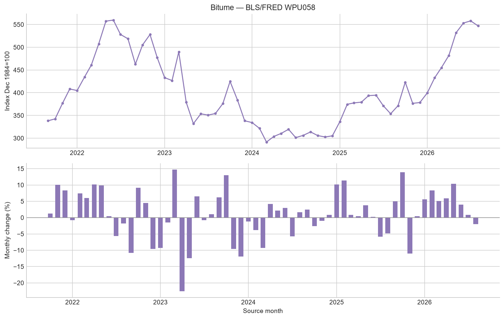

# Bitume — monthly index analysis

Source: [BLS/FRED WPU058](https://fred.stlouisfed.org/series/WPU058), **2021-09-01 → 2026-08-01**, 60 observed months. Unit: **Index Dec 1984=100**. Missing months: 0. Processed SHA-256: `4805cbb27ca7cd86b0fe1978cbd10a6166b602776cdba1b225bf4444a5d1ce71`.

Persistence and fixed-parameter damped Holt are compared separately at 1, 3 and 6 calendar months. The dashboard uses this same `chronological_endpoints_v1` endpoint protocol and selection rule: Lowest mean purged-CV endpoint MAE; require 2% improvement over persistence. Supplier USD/tonne prices stay separate; no daily index observations are invented. Statistics: [bitumen_statistics.csv](bitumen_statistics.csv). Forecast points, selected models and warnings: [bitumen_forecast.json](bitumen_forecast.json). Raw/processed audit: [bitumen_data_quality.json](bitumen_data_quality.json).

## Performance limitations

- **1 month(s):** Historique insuffisant pour comparer les modèles sur trois périodes de validation. Dernier prix connu retenu par défaut. Évaluation limitée : 11 prévisions testées sur la période finale. Données de calibration insuffisantes pour certaines bandes à 95 %. Ces bandes ne sont pas affichées.
- **3 month(s):** Historique insuffisant pour comparer les modèles sur trois périodes de validation. Dernier prix connu retenu par défaut. Évaluation limitée : 9 prévisions testées sur la période finale. Données de calibration insuffisantes pour certaines bandes à 95 %. Ces bandes ne sont pas affichées.
- **6 month(s):** Historique insuffisant pour comparer les modèles sur trois périodes de validation. Dernier prix connu retenu par défaut. Évaluation limitée : 6 prévisions testées sur la période finale. Données de calibration insuffisantes pour certaines bandes à 95 %. Ces bandes ne sont pas affichées.

## Same-date endpoint comparison: final holdout

| horizon_months | model | selected | samples | mae | mae_skill_vs_naive | calibration_samples | interval_coverage |
| --- | --- | --- | --- | --- | --- | --- | --- |
| 1 | naive | True | 11 | 26.4255 | 0.0000 | 8 | None |
| 1 | holt | False | 11 | 38.2252 | -0.4465 | 8 | None |
| 3 | naive | True | 9 | 59.3518 | 0.0000 | 6 | None |
| 3 | holt | False | 9 | 61.4992 | -0.0362 | 6 | None |
| 6 | naive | True | 6 | 124.1612 | 0.0000 | 3 | None |
| 6 | holt | False | 6 | 116.3598 | 0.0628 | 3 | None |

MAE/RMSE are in index points. Positive MAE skill means improvement over persistence; negative skill means worse. The first 65% of source months are used for purged validation, the next 15% for calibration, and the last 20% for final testing. Only an actual publication at the requested month is scored. Insufficient validation defaults to persistence; insufficient calibration leaves bands absent. Full comparison: [bitumen_model_comparison.csv](bitumen_model_comparison.csv). Historical publication timestamps and vintages are unavailable, so these checks use source months and cannot establish real-time availability. Overlapping pairs are dependent and nominal 95% bands are not coverage guarantees.
