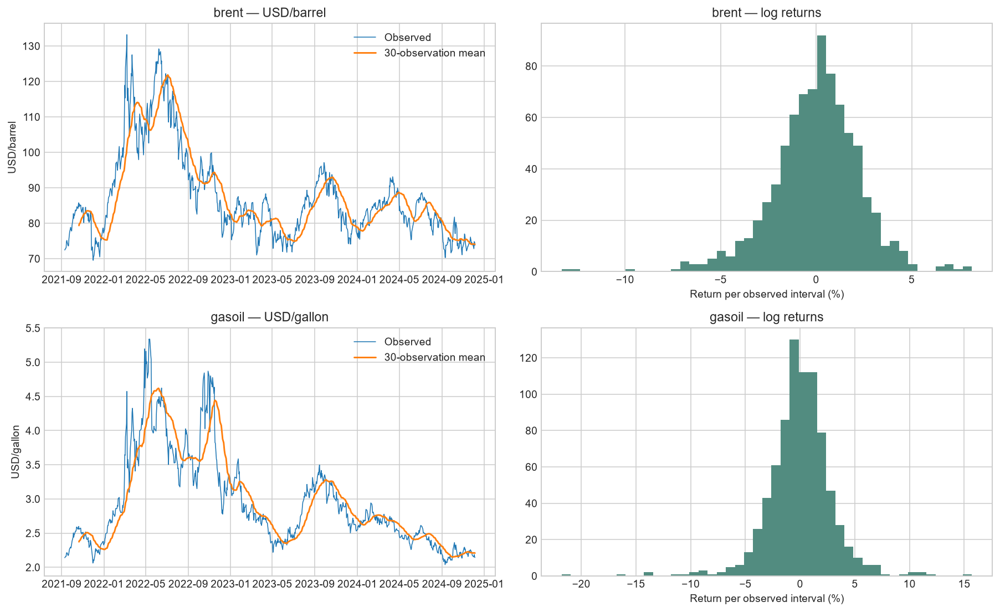
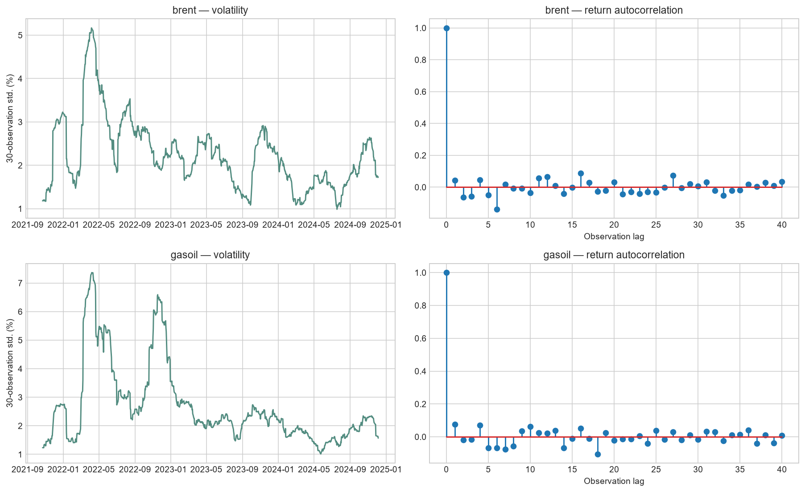
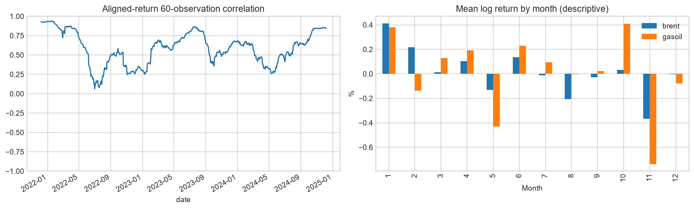

# Data science audit and results

Generated from the local snapshot **2021-09-10 → 2026-09-09**, 1287 rows.
SHA-256: `98aa047ab90dfec93ab188f50c79fd33b4b60188047560b6f132458ebb12aa26`. Full versions, split dates and code fingerprints: [manifest.json](manifest.json).

## Findings and corrections

- The original notebook had partial execution, no engineered features, and no ML comparison. Its purported next-observation baseline was a single-origin constant prediction across 60 observations; it now uses rolling one-step persistence.
- The live Holt implementation damped its accumulated forecast trend twice. The geometric sum is corrected. Missing calendar days now advance model state without creating observations; validation uses the same calendar-day horizons as the API.
- The live service and this research now share `chronological_endpoints_v1`: the same actual endpoint labels, chronological splits, purged folds, MAE selection rule, metrics and calibration quantiles. The research candidate registry assigns immutable snapshot versions, while ML candidates remain offline artifacts.
- Raw/processed local CSV agreement, missingness, finite positive prices, date uniqueness and chronology are checked before fitting. Local consistency does not authenticate the upstream provider or resolve historical revisions.

## Feature engineering and evaluation

Features cover lagged log returns, price/rolling-mean ratios, momentum, volatility, calendar cycles, gap length, and strictly earlier observations of the other product. Rolling windows count observations. Own price at origin is assumed published; cross-product features older than seven days are missing. Targets are actual observed prices, never interpolated.

Each direct model predicts the first publication on or after 1, 7, 30 or 90 calendar days (at most four days late). The exact label date is recorded. The live service scores these same endpoints; Holt advances to the actual publication date without changing its requested-horizon fitting window.

For each instrument's observed source dates, first 65%: development and expanding-window cross-validation. Next 15%: interval calibration. Last 20%: frozen final holdout. Training labels crossing a split boundary are purged. Imputation and scaling are fitted only on training folds. Boosting early stopping is disabled to avoid a random internal validation split. Candidates: persistence, corrected Holt, regularized linear regression (Ridge), histogram gradient boosting, and random forest. Hyperparameters and seed are fixed in source.

Selection uses validation MAE only, requiring at least 2% improvement over persistence. All candidate holdout scores are diagnostic; the holdout winner is not used to change the selection. Models stay frozen across calibration and holdout; baseline states use observations available at each origin, as real-time persistence does.

## Selected models: untouched holdout results

| product | horizon_days | model | mae | rmse | mae_skill_vs_naive | interval_coverage |
| --- | --- | --- | --- | --- | --- | --- |
| brent | 1 | naive | 2.3758 | 3.6631 | 0.0000 | 0.7897 |
| brent | 7 | naive | 5.4512 | 7.7257 | 0.0000 | 0.8710 |
| brent | 30 | naive | 12.4511 | 17.8633 | 0.0000 | 0.8664 |
| brent | 90 | naive | 23.9427 | 30.7276 | 0.0000 | 0.9105 |
| gasoil | 1 | naive | 0.0866 | 0.1252 | 0.0000 | 0.8554 |
| gasoil | 7 | naive | 0.1862 | 0.2548 | 0.0000 | 0.8618 |
| gasoil | 30 | naive | 0.4587 | 0.6310 | 0.0000 | 0.9782 |
| gasoil | 90 | naive | 0.7799 | 1.0459 | 0.0000 | 0.9630 |

MAE/RMSE use each product's own price unit; they must not be averaged across products. Positive skill means improvement over persistence; negative skill means worse. Interval coverage is a fraction. See [all model metrics](holdout_metrics.csv), [validation scores](cross_validation.csv), [split audit](split_audit.csv), and [predictions](holdout_predictions.csv).

## Live-model comparison and weak performance

| product | horizon_days | model | production_selected | validation_mae | samples | mae | mae_skill_vs_naive | interval_coverage |
| --- | --- | --- | --- | --- | --- | --- | --- | --- |
| brent | 1 | naive | True | 1.2610 | 252 | 2.3758 | 0.0000 | 0.7897 |
| brent | 1 | holt | False | 1.8074 | 252 | 3.2090 | -0.3507 | 0.8532 |
| brent | 7 | naive | True | 2.8499 | 248 | 5.4512 | 0.0000 | 0.8710 |
| brent | 7 | holt | False | 3.3204 | 248 | 5.8296 | -0.0694 | 0.8548 |
| brent | 30 | naive | True | 5.0693 | 232 | 12.4511 | 0.0000 | 0.8664 |
| brent | 30 | holt | False | 7.1622 | 232 | 15.1669 | -0.2181 | 0.9440 |
| brent | 90 | naive | True | 7.6980 | 190 | 23.9427 | 0.0000 | 0.9105 |
| brent | 90 | holt | False | 12.4233 | 190 | 31.1468 | -0.3009 | 1.0000 |
| gasoil | 1 | naive | True | 0.0561 | 249 | 0.0866 | 0.0000 | 0.8554 |
| gasoil | 1 | holt | False | 0.0766 | 249 | 0.1163 | -0.3425 | 0.8193 |
| gasoil | 7 | naive | True | 0.1252 | 246 | 0.1862 | 0.0000 | 0.8618 |
| gasoil | 7 | holt | False | 0.1408 | 246 | 0.2103 | -0.1297 | 0.8374 |
| gasoil | 30 | naive | True | 0.2616 | 229 | 0.4587 | 0.0000 | 0.9782 |
| gasoil | 30 | holt | False | 0.3555 | 229 | 0.6083 | -0.3261 | 1.0000 |
| gasoil | 90 | naive | True | 0.4099 | 189 | 0.7799 | 0.0000 | 0.9630 |
| gasoil | 90 | holt | False | 0.6297 | 189 | 1.1887 | -0.5242 | 1.0000 |

Persistence selection means no validated trend improvement. Negative final-test skill means the candidate underperformed the last known price. Coverage below 95% is below the uncertainty target, not evidence of reliable coverage. The selected-model [interval monitoring report](interval_monitoring.csv) records every horizon's calibration radius, historical stress radius, blocks, coverage gap and status. These warnings are prominent in the dashboard, alongside missing-band and small-sample warnings. [Production comparison](production_comparison.csv) and `production_selection_*.json` are generated by the same evaluator called by the API. The live selection is recomputed on its current instrument history, so a later snapshot may choose differently.

Short-horizon bands use finite-sample absolute log-error quantiles from the separate calibration period, specific to the selected model and displayed forecast step. For daily horizons of 30 days or longer and monthly horizons of 3 months or longer, the band is widened to the larger of that calibration radius and the largest error from at least 8 non-overlapping earlier forecast blocks. This historical stress envelope addresses missed volatility regimes without using final-test prices. If that independent evidence is unavailable, the long-horizon band is withheld. At least 19 calibration errors are still needed for the 95% calibration quantile. The envelope improved the supplied long-horizon holdout, but it is not a guarantee of future 95% coverage.

## Controlled live model lifecycle

Every research candidate is assigned a snapshot-specific identity in [model_lifecycle_candidates.json](model_lifecycle_candidates.json) and [model_lifecycle_candidates.csv](model_lifecycle_candidates.csv). That registry is an offline review record, not a production switch: a research artifact must be separately packaged into the small live runtime before it can be considered.

The live runtime versions its persistence and Holt candidates, issues the non-production candidate beside the production model for identical instrument/origin/target endpoints, and records both outcomes. Promotion requires at least **30 paired live actuals**, at least **5% lower MAE** than the production candidate, no worse MAE than the issued last-known-price baseline, and at least **85% interval coverage across 20 resolved intervals**. A non-persistence production candidate is rolled back to persistence after at least **30 live actuals** if it is more than **10% worse** than that baseline. Candidate status and the append-only event log are available from `GET /api/model-lifecycle`.

## Procurement decision: request quotes now or wait

The tested use case is **requesting or refreshing competitive supplier quotes now** when the selected forecast expects the market benchmark to rise by at least **2%** by the recorded target publication. It is compared with a simple rule that requests quotes only after the same **2%** rise has already appeared in the previous **7** calendar days. The actual outcome is a material rise at the target. The score reports early RFQs that identified a rise, unnecessary RFQs, missed rises, and the share of one-unit market-price upside identified before the target.

| product | horizon_days | forecast_model | policy | samples | rfq_requests | correct_early_rfq | unnecessary_rfq | missed_material_rise | precision | recall | upside_capture_pct | forecast_minus_momentum_upside_capture_pp |
| --- | --- | --- | --- | --- | --- | --- | --- | --- | --- | --- | --- | --- |
| brent | 1 | naive | forecast | 252 | 0 | 0 | 0 | 62 | — | 0.0000 | 0.0000 | -58.5760 |
| brent | 1 | naive | seven_day_momentum | 252 | 101 | 29 | 72 | 33 | 0.2871 | 0.4677 | 0.5858 | -58.5760 |
| brent | 7 | naive | forecast | 248 | 0 | 0 | 0 | 102 | — | 0.0000 | 0.0000 | -47.8413 |
| brent | 7 | naive | seven_day_momentum | 248 | 97 | 38 | 59 | 64 | 0.3918 | 0.3725 | 0.4784 | -47.8413 |
| brent | 30 | naive | forecast | 232 | 0 | 0 | 0 | 106 | — | 0.0000 | 0.0000 | -38.9250 |
| brent | 30 | naive | seven_day_momentum | 232 | 88 | 39 | 49 | 67 | 0.4432 | 0.3679 | 0.3892 | -38.9250 |
| brent | 90 | naive | forecast | 190 | 0 | 0 | 0 | 107 | — | 0.0000 | 0.0000 | -32.0078 |
| brent | 90 | naive | seven_day_momentum | 190 | 73 | 34 | 39 | 73 | 0.4658 | 0.3178 | 0.3201 | -32.0078 |
| gasoil | 1 | naive | forecast | 249 | 0 | 0 | 0 | 65 | — | 0.0000 | 0.0000 | -55.6256 |
| gasoil | 1 | naive | seven_day_momentum | 249 | 110 | 32 | 78 | 33 | 0.2909 | 0.4923 | 0.5563 | -55.6256 |
| gasoil | 7 | naive | forecast | 246 | 0 | 0 | 0 | 110 | — | 0.0000 | 0.0000 | -54.1996 |
| gasoil | 7 | naive | seven_day_momentum | 246 | 108 | 54 | 54 | 56 | 0.5000 | 0.4909 | 0.5420 | -54.1996 |
| gasoil | 30 | naive | forecast | 229 | 0 | 0 | 0 | 120 | — | 0.0000 | 0.0000 | -49.9535 |
| gasoil | 30 | naive | seven_day_momentum | 229 | 96 | 49 | 47 | 71 | 0.5104 | 0.4083 | 0.4995 | -49.9535 |
| gasoil | 90 | naive | forecast | 189 | 0 | 0 | 0 | 105 | — | 0.0000 | 0.0000 | -34.4424 |
| gasoil | 90 | naive | seven_day_momentum | 189 | 76 | 40 | 36 | 65 | 0.5263 | 0.3810 | 0.3444 | -34.4424 |

**Decision result: do not use the current forecast to trigger RFQs.** Every selected model is persistence in this snapshot, so the forecast policy made no early requests and captured none of the material-rise opportunities.

This is a quote-timing evaluation, not a purchase recommendation. `identified_upside_per_unit` is a market-exposure proxy, not realised savings: the snapshot contains no historical RFQ issue times, supplier response times, quote validity, or executable landed costs. The detailed decisions and both policies are in [rfq_timing_decisions.csv](rfq_timing_decisions.csv); [rfq_timing_backtest.csv](rfq_timing_backtest.csv) contains the policy summary. A future landed-cost decision evaluation must join these decisions to the versioned supplier quote record, its currency and every cost component.

## EDA and interpretation

Model diagnostics use development dates only (through 2024-12-05). Price/return distributions, rolling volatility, ACF, calendar seasonality, ADF/KPSS stationarity tests, aligned-return correlation and robust shock flags are included. ADF's null is a unit root; KPSS's null is level stationarity. Their assumptions and structural breaks limit conclusions. Warnings and bounded p-values are retained. Seasonal patterns are descriptive, not evidence of a repeatable trading effect.

Aligned-return correlation: **0.558**. Both products use exactly the same start/end dates for this calculation. Flagged shocks: **33**, automatically removed: **0**. Missing weekdays include holidays and must not all be called data failures.

Calibration-set permutation importance is saved in [feature_importance.csv](feature_importance.csv). It measures changes in log-return MAE, not causal effects. Correlated features can substitute for one another, so importance is not a feature-deletion rule.

## Limits and next decisions

- No ML model is automatically promoted to the live app. Research output is versioned in the candidate registry, then requires a separately packaged live candidate and the paired shadow promotion criteria above.
- Historical provider publication timestamps and vintages remain unavailable for the delivered snapshot. Source-date causality prevents mechanical future leakage, but this snapshot cannot prove what would have been known at every past origin. Migration `015` now captures append-only provider vintages, the provider availability timestamp and the application capture timestamp for new collections; `GET /api/vintages/as-of` admits a value only after this application captured it, so it can build future as-of training snapshots from those records. Reconstructed collection times from the legacy import remain excluded from that route and cannot establish actual availability.
- The RFQ timing check measures market-exposure opportunities only. Historical supplier quote issue/response timestamps, validity, quantities, FX and landed cost components are not available, so it cannot prove realised savings or rank suppliers retrospectively.
- Bitumen is covered separately by its monthly BLS/FRED WPU058 index: [monthly report](bitumen_report.md), statistics, 1/3/6-month forecasts and walk-forward scores. It is not mixed into the daily price ML experiment or relabeled as USD/tonne.
- Overlapping horizons and serial dependence mean fold errors are not independent. Calibration has a 95% target, while long horizons add a non-overlapping historical stress envelope; neither gives a future coverage guarantee. Use the measured holdout and live coverage in [interval_monitoring.csv](interval_monitoring.csv) and `GET /api/forecast-performance`.
- Check fresh-data errors, missingness, feature ranges and interval coverage after deployment; reassess on new chronological data, not by repeatedly tuning to this holdout. Add monthly bitumen publications until at least 84 months are available for trusted long-horizon uncertainty. Use block-bootstrap uncertainty or non-overlapping evaluation when more history is available.
- Serialized models, if requested, are research artifacts fitted on development only, with their training cutoff in each model card. Never load untrusted pickle/joblib files. Baseline artifacts contain `model=None` and an explicit baseline name.

## References

- [BLS/FRED WPU058 monthly index](https://fred.stlouisfed.org/series/WPU058)

- [scikit-learn: lagged features and time-series validation](https://scikit-learn.org/stable/auto_examples/applications/plot_time_series_lagged_features.html)
- [Forecasting: Principles and Practice — damped Holt equations](https://otexts.com/fpp3/holt.html)
- [Forecasting: Principles and Practice — time-series cross-validation](https://otexts.com/fpp3/tscv.html)
- [Ryan Tibshirani — finite-sample conformal calibration](https://www.stat.cmu.edu/~ryantibs/talks/conformal-2022.pdf)
- [scikit-learn: permutation importance](https://scikit-learn.org/stable/modules/generated/sklearn.inspection.permutation_importance.html)
